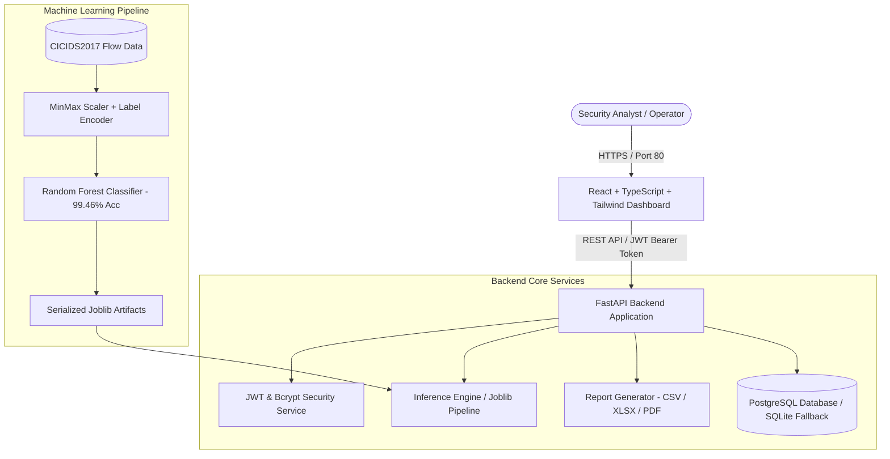
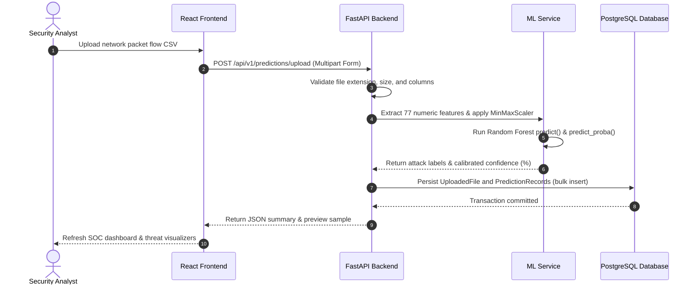
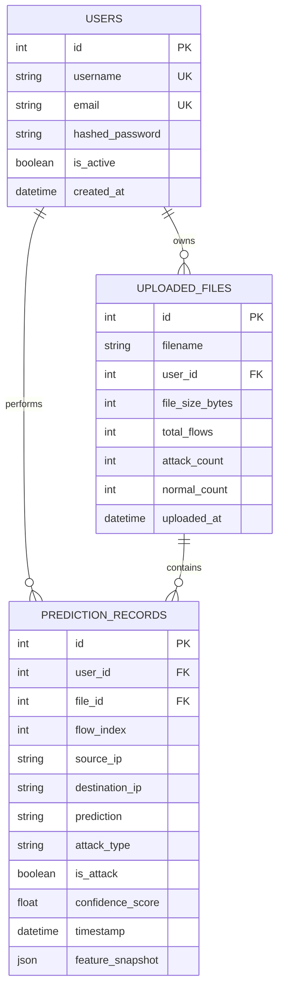

# 🛡️ AI-Powered Network Intrusion Detection System

[](https://www.python.org/)
[](https://fastapi.tiangolo.com/)
[](https://react.dev/)
[](https://www.typescriptlang.org/)
[](https://tailwindcss.com/)
[](https://www.postgresql.org/)
[](https://www.docker.com/)

A modern, production-ready, full-stack Machine Learning Network Intrusion Detection System (IDS) built with **FastAPI**, **PostgreSQL**, **React (Vite + TypeScript)**, and **Tailwind CSS**. The system ingests, normalizes, and classifies high-dimensional network flow data into normal traffic and multiple threat categories (DoS, PortScan, BruteForce, Botnet, Web Attacks) with a **99.46% test accuracy** on the benchmark **CICIDS2017** dataset.

---

## 📑 Table of Contents

1. [Key Features](#-key-features)
2. [Target Architecture](#-target-architecture)
3. [Technology Stack](#-technology-stack)
4. [Database Schema](#-database-schema)
5. [Machine Learning Pipeline & Integrity](#-machine-learning-pipeline--integrity)
6. [API Endpoints](#-api-endpoints)
7. [Getting Started & Local Setup](#-getting-started--local-setup)
8. [Docker Deployment](#-docker-deployment)
9. [Automated Testing](#-automated-testing)
10. [Model Limitations](#-model-limitations)
11. [Independent Implementation & Contributions](#-independent-implementation--contributions)
12. [Citations & Acknowledgements](#-citations--acknowledgements)
13. [License](#-license)

---

## 🌟 Key Features

- ⚡ **Real-Time & Batch ML Inference**: Preprocesses and classifies network traffic flows across 77 numerical features using a serialized Random Forest ensemble model.
- 🔐 **Robust JWT & Bcrypt Authentication**: Secure user registration, password hashing with salt, role/session management, and protected API routes.
- 📊 **Cybersecurity SOC Dashboard**: Live threat telemetry, interactive threat distribution bar charts, daily volume trends, confidence histograms, and recent flow alerts.
- 📁 **CSV Upload & Flow Validation**: Drag-and-drop network flow CSV file ingestion with automatic feature normalization and simulated network topology routing.
- 🔍 **Search, Filter & Pagination**: Multi-parameter search across IP addresses, threat categories, and detection flags with paginated server-side queries.
- 📄 **Multi-Format Export Engine**: On-demand generation and streaming of audit reports in **CSV**, **Excel (.xlsx)**, and formatted **PDF** formats.
- 🐳 **Containerized Deployment**: Complete multi-service orchestration with Docker and Docker Compose (PostgreSQL, FastAPI backend, React/Nginx frontend).

---

## 🏗️ Target Architecture

### System Flowchart



### Batch Ingestion Sequence



---

## 💻 Technology Stack

| Layer | Technologies |
| :--- | :--- |
| **Backend** | Python 3.10+, FastAPI, SQLAlchemy, Pydantic, Pydantic-Settings, Uvicorn |
| **Database** | PostgreSQL 15 (Production) / SQLite3 (Zero-setup local development) |
| **Frontend** | React 19, TypeScript, Vite, Tailwind CSS v4, Lucide React, Axios, React Router v7 |
| **Data & Charts** | Recharts, Pandas, NumPy, OpenPyXL, ReportLab |
| **Machine Learning**| Scikit-learn, Joblib, XGBoost (optional reference) |
| **Security** | JWT (jose), Bcrypt, OAuth2 Password Bearer, CORS middleware, strict validation |
| **DevOps** | Docker, Docker Compose, Nginx (Alpine Linux) |

---

## 🗄️ Database Schema



---

## 🔬 Machine Learning Pipeline & Integrity

### Dataset Attribution & Characteristics
- **Dataset**: **CICIDS2017** created by the Canadian Institute for Cybersecurity (University of New Brunswick).
- **Format**: Bidirectional network flow statistics generated using CICFlowMeter.
- **Samples**: 56,661 preprocessed flow records in the stratified sample dataset.
- **Target Variable**: Multi-class categorization: `BENIGN`, `DoS`, `PortScan`, `BruteForce`, `Bot`, `WebAttack`, and `Infiltration`.

### Preprocessing Pipeline
1. **Cleaning**: Stripping whitespace from column names, filtering non-numeric features, and imputing infinite (`np.inf`) and missing values with zero.
2. **Feature Alignment**: Ensuring incoming inputs conform to the 77 expected flow feature names in exact order.
3. **Scaling**: `MinMaxScaler` normalization fitted on the training split and serialized to `scaler.joblib`.
4. **Encoding**: `LabelEncoder` mapping categorical attack classes to numerical identifiers and serialized to `label_encoder.joblib`.

### Actual Measured Metrics
- **Model Architecture**: Random Forest Classifier (`n_estimators=100`, `random_state=42`).
- **Evaluation Split**: 80% Training / 20% Testing (Stratified).
- **Test Set Accuracy**: **99.46%**
- **Weighted F1-Score**: **0.99**

---

## 🔌 API Endpoints

The interactive OpenAPI / Swagger UI is available at `/api/v1/docs`.

| Method | Endpoint | Description | Auth Required |
| :--- | :--- | :--- | :--- |
| `POST` | `/api/v1/auth/register` | Register a new security analyst account | No |
| `POST` | `/api/v1/auth/login` | Authenticate and obtain JWT bearer token | No |
| `GET` | `/api/v1/auth/me` | Fetch authenticated user profile | Yes (Bearer JWT) |
| `POST` | `/api/v1/predictions/upload` | Upload packet flow CSV for batch inference | Yes (Bearer JWT) |
| `POST` | `/api/v1/predictions/predict-single` | Real-time classification for single flow | Yes (Bearer JWT) |
| `GET` | `/api/v1/predictions/dashboard-stats` | Aggregated threat analytics & metrics | Yes (Bearer JWT) |
| `GET` | `/api/v1/predictions/history` | Paginated, searchable prediction log | Yes (Bearer JWT) |
| `GET` | `/api/v1/predictions/export` | Download audit reports (`csv`, `xlsx`, `pdf`) | Yes (Bearer JWT) |
| `GET` | `/health` | Application health and ML engine status | No |

---

## 🚀 Getting Started & Local Setup

### Prerequisites
- Python 3.10+
- Node.js 18+ and npm
- (Optional) Docker and Docker Compose

### 1. Backend Setup

```bash
# Navigate to backend directory
cd backend

# Create and activate virtual environment
python -m venv .venv

# On Linux/macOS:
source .venv/bin/activate
# On Windows (PowerShell):
.\.venv\Scripts\Activate.ps1

# Install required dependencies
pip install -r requirements.txt

# (Optional) Retrain or re-serialize the ML model artifacts
python scripts/train_and_save_model.py

# Start FastAPI server
uvicorn app.main:app --reload --port 8000
```

FastAPI server runs at `http://localhost:8000` with documentation at `http://localhost:8000/api/v1/docs`.

### 2. Frontend Setup

```bash
# In a new terminal, navigate to frontend directory
cd frontend

# Install dependencies
npm install

# Start Vite development server
npm run dev
```

Open `http://localhost:5173` in your browser.

---

## 🐳 Docker Deployment

To launch the complete application stack (PostgreSQL + FastAPI + React/Nginx) with a single command:

```bash
docker compose up --build
```

- **Frontend Application**: `http://localhost`
- **Backend API**: `http://localhost:8000`
- **PostgreSQL Database**: `localhost:5432`

---

## 🧪 Automated Testing

Automated test suites verify both ML inference accuracy and REST API contract compliance:

```bash
# 1. Test ML Pipeline Inference (loads artifacts & executes sample prediction)
python backend/scripts/test_ml_service.py

# 2. Test Backend API Endpoints (Auth, Upload, Prediction, Dashboard, Exports)
python backend/scripts/test_api_endpoints.py

# 3. Validate Frontend TypeScript and Production Bundle
cd frontend
npm run build
```

---

## ⚠️ Model Limitations

1. **Flow-Level vs. Deep Packet Inspection**: The model analyzes flow statistical summaries (durations, packet sizes, inter-arrival times) rather than raw packet payloads. It does not inspect encrypted application-layer contents (e.g., TLS payload).
2. **Offline Flow Ingestion**: The system processes pre-aggregated CSV flow logs (from tools such as CICFlowMeter or Zeek/Suricata export). It does not include an in-kernel raw packet capture driver (libpcap/eBPF).
3. **Class Imbalance & Rare Attacks**: Attacks with very low frequency in the benchmark training dataset (such as Infiltration or Heartbleed) have higher variance than high-volume attacks (DoS, PortScan).
4. **Adversarial Evasion**: Statistical classifiers can be vulnerable to traffic padding, artificial jitter injection, and low-and-slow rate evasion techniques.

---

## 💡 Independent Implementation & Contributions

This project was built as an independent, full-stack software engineering project designed for a portfolio and campus placements:

- **Original Full-Stack Architecture**: Designed and built the complete decoupled FastAPI backend, asynchronous REST endpoints, and React 19 single-page application from scratch.
- **Production Data Pipeline**: Implemented robust file validation, schema alignment, defensive data sanitization, and automated batch processing.
- **Security & Authorization**: Built the JWT token generation, password hashing with salt, role protection, and CORS policies.
- **Reporting Engine**: Engineered streaming export services capable of generating CSV, Excel spreadsheets, and styled multi-page PDF audit reports.
- **SOC Visualization UI**: Designed an operator-focused dark cybersecurity dashboard featuring real-time metrics, Recharts threat distribution, and paginated logs.
- **Infrastructure & Containerization**: Wrote multi-stage Dockerfiles and Docker Compose configuration for production containerization.

---

## 📚 Citations & Acknowledgements

The machine learning research foundations and dataset utilized in this system are attributed to:

1. **Tree-Based IDS Research**:
   > L. Yang, A. Moubayed, I. Hamieh and A. Shami, *"Tree-Based Intelligent Intrusion Detection System in Internet of Vehicles,"* 2019 IEEE Global Communications Conference (GLOBECOM), 2019, pp. 1-6, doi: `10.1109/GLOBECOM38437.2019.9013892`.
2. **MTH-IDS Research**:
   > L. Yang, A. Moubayed, and A. Shami, *"MTH-IDS: A Multi-Tiered Hybrid Intrusion Detection System for Internet of Vehicles,"* IEEE Internet of Things Journal, vol. 9, no. 1, pp. 616-632, Jan. 1, 2022.
3. **LCCDE Ensemble Research**:
   > L. Yang, A. Shami, G. Stevens, and S. DeRusett, *"LCCDE: A Decision-Based Ensemble Framework for Intrusion Detection in The Internet of Vehicles,"* 2022 IEEE Global Communications Conference (GLOBECOM), 2022.
4. **CICIDS2017 Benchmark Dataset**:
   > Canadian Institute for Cybersecurity (CIC), University of New Brunswick (UNB), [https://www.unb.ca/cic/datasets/ids-2017.html](https://www.unb.ca/cic/datasets/ids-2017.html).

---

## 📜 License

Distributed under the **MIT License**. See [LICENSE](LICENSE) for full terms. Third-party research references and datasets remain under their respective licenses and terms of use.
