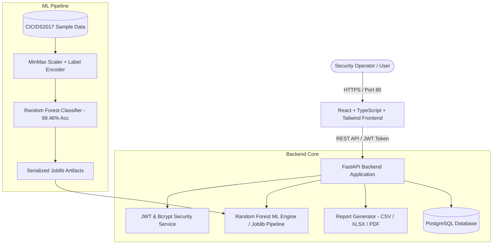
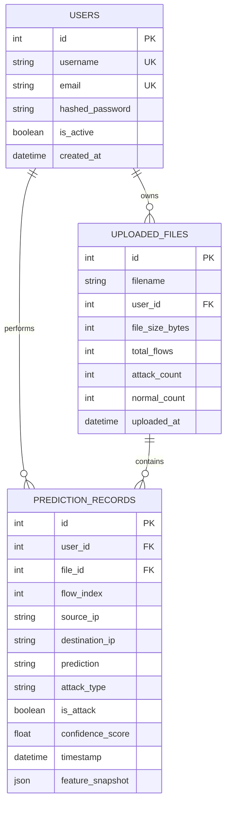
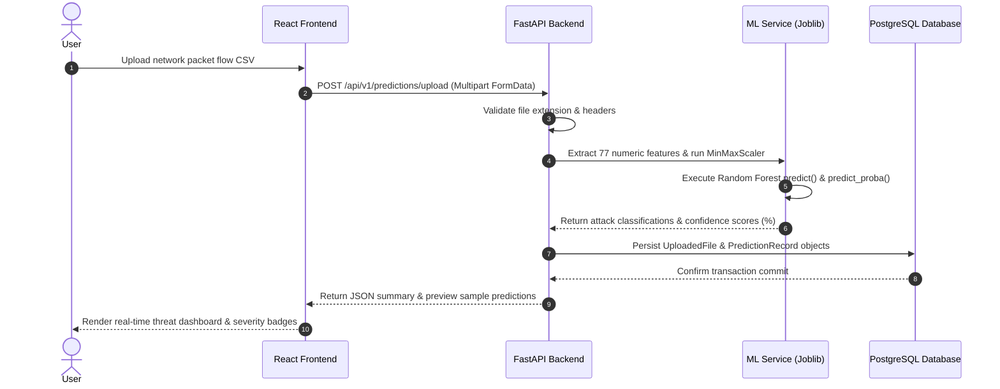

# System Architecture & Technical Specifications

## Aegis AI Intrusion Detection System (Full-Stack Architecture)

This document details the system design, data flow, ML model inference pipeline, normalized database schema, and deployment topology.

---

## 1. High-Level System Architecture

---

## 2. Database ER Diagram (Normalized Schema)

---

## 3. CSV File Upload & Machine Learning Prediction Sequence

---

## 4. API Endpoints Overview

| Method | Endpoint | Description | Auth Required |
| :--- | :--- | :--- | :--- |
| `POST` | `/api/v1/auth/register` | Register new analyst account | No |
| `POST` | `/api/v1/auth/login` | Login and acquire JWT bearer token | No |
| `GET` | `/api/v1/auth/me` | Fetch authenticated user profile | Yes (JWT) |
| `POST` | `/api/v1/predictions/upload` | Upload packet flow CSV for ML batch prediction | Yes (JWT) |
| `POST` | `/api/v1/predictions/predict-single` | Real-time prediction for single flow | Yes (JWT) |
| `GET` | `/api/v1/predictions/dashboard-stats` | Aggregated threat analytics & metrics | Yes (JWT) |
| `GET` | `/api/v1/predictions/history` | Paginated, searchable prediction history | Yes (JWT) |
| `GET` | `/api/v1/predictions/export` | Download audit reports in CSV, XLSX, or PDF | Yes (JWT) |
